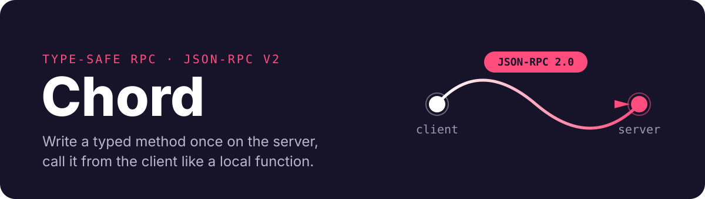

<div id="header" align="center">


<br/>

<a href="https://www.typescriptlang.org/"></a>
<a href="https://kit.svelte.dev/"></a>
<a href="https://expressjs.com/"></a>
<a href="https://www.jsonrpc.org/specification"></a>
</div>

<div align="center">
  
  
  
  
</div>

## ✅ Used inside

<div align="center">
  <a href="https://sbermarketing.ru">
    
  </a>
</div>

## 🥏 Why?

As a project grows, client-server communication becomes a maintenance burden. Hundreds of __REST API__ endpoints erode [Developer Experience](https://github.blog/2023-06-08-developer-experience-what-is-it-and-why-should-you-care/). [GraphQL](https://graphql.org/) feels heavy for many use cases, and [gRPC](https://grpc.io/) is built for server-to-server, not the browser.

That's where __Chord__ comes in: you write a typed method once, then call it from the client as if it lived in the same file.

## ✨ Features

* **Protocol-agnostic** — speaks [JSON-RPC v2](https://www.jsonrpc.org/specification), so you own the transport
* **Framework-agnostic** — ready middlewares for [SvelteKit](https://kit.svelte.dev/) and [Express](https://expressjs.com/), and any backend can plug in
* **Type-safe end-to-end** — one typed method shared by server and client
* **IDE autocompletion** out of the box — no codegen, no schema sync
* **Tiny client** — under 2 KB gzipped
* **Batteries included** — batch requests, caching, middleware, and Zod validation

## ⚙️ Installation

**Chord** works with any backend library. Install it from [npm](https://www.npmjs.com/package/@chord-ts/rpc) with your favorite package manager

```bash
npm install @chord-ts/rpc
# or
pnpm install @chord-ts/rpc
```

**Chord** uses [decorators](https://www.typescriptlang.org/docs/handbook/decorators.html) and [reflection](https://developer.mozilla.org/en-US/docs/Web/JavaScript/Reference/Global_Objects/Reflect) under the hood to build the server and client. So you need to configure your _tsconfig.json_ first

**`./tsconfig.json`**

```json5
{
  compilerOptions: {
    // Other stuff...

    target: 'ESNext',
    experimentalDecorators: true,
    emitDecoratorMetadata: true
  }
}
```

### ⚠️ Caveats

If you use [Vite](https://vitejs.dev/) as your bundler, note that the [ESbuild](https://esbuild.github.io/) underneath [does not support](https://github.com/evanw/esbuild/issues/257) the _emitDecoratorMetadata_ flag yet

The workaround is [SWC](https://www.npmjs.com/package/unplugin-swc): it fixes the issue without adding noticeable rebuild overhead. Add the plugin to [Vite](https://vitejs.dev/):

**`./vite.config.ts`**

```javascript
import { sveltekit } from '@sveltejs/kit/vite';
import { defineConfig } from 'vitest/config';
import swc from 'unplugin-swc';

export default defineConfig({
  plugins: [sveltekit(), swc.vite()],
  test: {
    include: ['src/**/*.{test,spec}.{js,ts}']
  }
});
```

## 🛠️ Usage

The example below uses [SvelteKit](https://kit.svelte.dev/), but the same pattern works on [Next.js](https://nextjs.org/), [Nuxt](https://nuxt.com/), or any other framework

### 📝 Implement the Class

Implement your controller as a class. In [SvelteKit](https://kit.svelte.dev/) that's a [+server.ts](https://kit.svelte.dev/docs/routing#server) file

**`./src/routes/+server.ts`**

```typescript
import { json } from '@sveltejs/kit';
import { Composer, rpc, type Composed } from '@chord-ts/rpc'; // Main components of Chord we will use
import { sveltekitMiddleware } from '@chord-ts/rpc/middlewares'; // Middleware to process RequestEvent object

// 1. Implement the class containing RPC methods
export class Say {
  @rpc() // Use decorator to register callable method
  hello(name: string): string {
    return `Hello, ${name}!`;
  }
}

// 2. Init Composer instance that will handle requests
export const composer = Composer.init({ Say: new Say() });

// 3. Create a type that will be used on frontend
export type Client = typeof composer.clientType;

composer.use(sveltekitMiddleware()); // Use middleware to process SvelteKit RequestEvent

// 4. SvelteKit syntax to define POST endpoint
export async function POST(event) {
  // Execute request in place and return result of execution
  return json(await composer.exec(event));
}
```

The listing defines everything needed to handle requests. The first three steps are the same for any framework; only the fourth changes. For other backends, write a middleware that extracts the request body.

### 🖼️ Use RPC on frontend

Now call the method from the client. As we use [SvelteKit](https://kit.svelte.dev/), we have the full power of [Svelte](https://svelte.dev/) for the UI

**`./src/routes/+page.svelte`**

```html
<script lang="ts">
  import { client } from '@chord-ts/rpc/client';
  import { onMount } from 'svelte';

  // Import our Contract
  import type { Client } from './+server';

  // Init dynamic client with type checking
  // Use Contract as Generic to get type safety and hints from IDE
  // dynamicClient means that RPC will be created during code execution
  // and executed when the function call statement is found
  const rpc = client<Client>({ endpoint: '/' });

  let res;
  // Called after Page mount. The same as useEffect(..., [])
  onMount(async () => {
    // Call method defined on backend with type-hinting
    res = await rpc.Say.hello('world');
    console.log(res);
  });
</script>

<h1>Chord call Test</h1>
<p>Result: {res}</p>
```

## 📦 Try it yourself

Ready to run sandbox with prepared environment for your experiments

<a href="https://www.sveltelab.dev/rkt1wa1z8trbcuc?files=.%2Fsrc%2Froutes%2F%2Bpage.svelte%2C.%2Fsrc%2Froutes%2F%2Bserver.ts" target="_blank"></a>

## 📚 Further reading

The example above is only the beginning. The [documentation](https://chord.vercel.app) walks through validation, middleware, caching, and batch requests — and the full reference lives in [`/docs`](./docs).